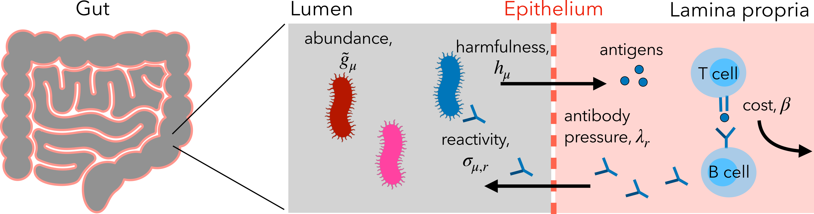

# Rational T cell repertoire allocation to control the gut microbiota
The gut microbiota shapes host metabolism, development and immunity, yet how the host regulates its composition in the presence of complex ecological interactions remains poorly understood. Recent experiments that measured T cell reactivity to individual strains in germ-free mice inoculated with a defined microbial community found that T cell recognition across microbial strains is sparse but broad, with a few polyspecific clones recognizing antigens shared across taxonomically diverse strains. Reanalyzing these experiments, we show that these T cell responses are associated with abundance changes of the strains they target. To interpret these findings, we develop a model linking the T cell repertoire to microbial abundances, in which a repertoire is allocated to minimize microbe-driven harm at the cost of maintaining an immune response. The model rationalizes the observed sparsity of gut T cell reactivity and shows that this allocation can emerge from competition between T cells for microbe-derived antigens. Finally, we find that while immune recognition can regulate microbial abundances, ecological interactions between strains may interfere with this mechanism. Together, these results provide a quantitative framework for immune control of gut microbial composition and identify principles governing the organization of T cell repertoires in the gut.

> Obinna Ukogu, Stanford University (oukogu@stanford.edu)

This repository contains code and scripts for [^1].

## References

[^1]: Ukogu, O. A., Bilate, A. M., Mora, T., Walczak, A. M. & Nourmohammad, A. Rational T cell repertoire allocation to control the gut microbiota. arXiv [physics.bio-ph] (2026) doi:10.48550/arXiv.2610.26779.
  

  
